

  <a href="https://genoffice.ai/">
    <picture>
      <source srcset="../assets/readme/hero-dark.webp" media="(prefers-color-scheme: dark)">
      
    </picture>
  </a>

<h1 align="center">GenOffice</h1>

<b>全球首个完整的开源 AI 办公套件。</b> 
Word、Excel、PowerPoint 和 PDF 文件，由你和你的 AI 共同编辑，以原生格式保存。

  
  
  
  

<a href="../../README.md">English</a> · <a href="README.es.md">Español</a> · <a href="README.pt-BR.md">Português (Brasil)</a> · <a href="README.de.md">Deutsch</a> · <b>Français</b> · <a href="README.zh-CN.md">简体中文</a> · <a href="README.zh-TW.md">繁體中文</a> · <a href="README.ko.md">한국어</a> · <a href="README.ja.md">日本語</a> · <a href="README.ar.md">العربية</a> · <a href="README.ru.md">Русский</a> · <a href="README.it.md">Italiano</a> · <a href="README.nl.md">Nederlands</a> · <a href="README.pl.md">Polski</a> · <a href="README.cs.md">Čeština</a> · <a href="README.id.md">Bahasa Indonesia</a> · <a href="README.ms.md">Bahasa Melayu</a> · <a href="README.th.md">ไทย</a> · <a href="README.hi.md">हिन्दी</a> · <a href="README.he.md">עברית</a>

  <a href="#download"><b>下载</b></a> ·
  <a href="#command-line-and-agent-skill"><b>CLI</b></a> ·
  <a href="#mcp-server"><b>MCP</b></a> ·
  <a href="https://genoffice.ai/"><b>网站</b></a> ·
  <a href="https://genoffice.ai/join"><b>社区</b></a> ·
  <a href="../../PRIVACY.md"><b>隐私</b></a>

GenOffice 是 Microsoft Office 的免费开源替代品，支持
macOS、Windows 和 Linux。它能打开并保存原生
`.docx`、`.xlsx` 和 `.pptx` 文件，可编辑 PDF、Markdown 和 HTML，
并将 AI 智能体置于每个文档的核心——不是简单挂在侧边的
聊天窗口，而是一个能读取文件、执行修改、并向你精确展示
改动内容的编辑器。

- **原生格式，逐位保留。** 只重写你修改的部分，文件其余内容
  原样保留，因此你的文档在 Word、Excel 和 PowerPoint 中
  依然正常可用。
- **可验证的 AI。** 修改以修订标记和 diff 形式呈现，一键撤销。
  电子表格获得真实公式，而非粘贴的数字。
  幻灯片和页面直接在画布上生成，且完全可编辑。
- **本地优先设计。** 文件的打开、编辑、保存和转换都在你的
  机器上完成。PDF → Word / Excel / PowerPoint、Markdown → Word
  和 HTML → Word 转换全部本地执行。只有 AI 调用会离开
  机器，发往你选择的提供商。
- **用你的密钥，或不用密钥。** 使用 Genspark 登录即可免密钥，
  或使用你自己的 Claude、OpenAI、Gemini、DeepSeek、
  Kimi、GLM、Qwen、Doubao、MiniMax、Grok、Mistral、OpenRouter、Requesty 密钥，或任何兼容 OpenAI 的
  端点，包括本地服务器。
- **可脚本化，面向智能体。** 应用内置 `genoffice` 命令行
  和适用于 Claude Code、Codex、Cursor、Gemini
  CLI、GitHub Copilot、OpenCode 和 Windsurf 的 skill，编码智能体
  无需打开窗口即可在你的机器上创建、转换、读取和修改真实的 Office 文件。

**下载：** [macOS](https://github.com/genspark-ai/genoffice/releases/latest)（Apple Silicon 和 Intel）·
[Windows](https://github.com/genspark-ai/genoffice/releases/latest)（x64 和 Arm）·
[Linux](https://github.com/genspark-ai/genoffice/releases/latest)（deb、rpm、AppImage）——
详情和前提条件见[下载](#download)部分。

## 演示

六个应用，一个 AI 面板，以及一条供编码智能体使用的命令行。
每张截图都展示 macOS 上的真实应用，
AI 由面板中可见的提示词驱动。

### 1 · Docs — 打开并编辑 `.docx`，AI 可验证

<table>
<tr>
<td width="50%">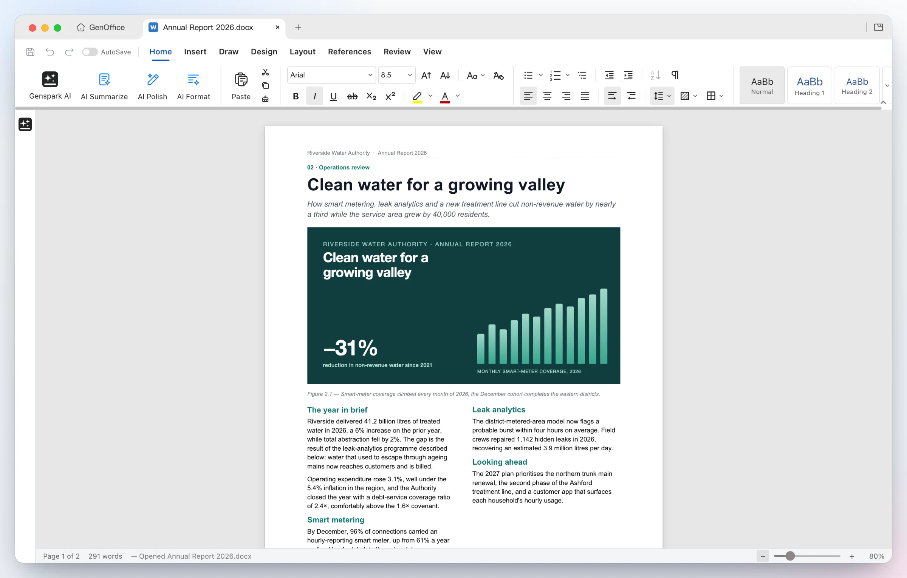</td>
<td width="50%"></td>
</tr>
<tr>
<td><b>像 Word 一样排版打开文件</b> — 双栏分节、整页图片、带底纹表格、页眉页脚、基于 Word 行度量的分页。样式、批注、修订、公式和手写标注往返后均不受损。</td>
<td><b>提出修改要求</b> — AI 读取所需区块，重写 Overview 部分并插入新的项目符号部分。每次 AI 操作都是一个可撤销的快照；开启<b>修订</b>后，改动以 Word 风格的修订形式呈现。</td>
</tr>
</table>

### 2 · Sheets — 带实时公式和图表的 `.xlsx`，而非粘贴的数字

<table>
<tr>
<td width="50%">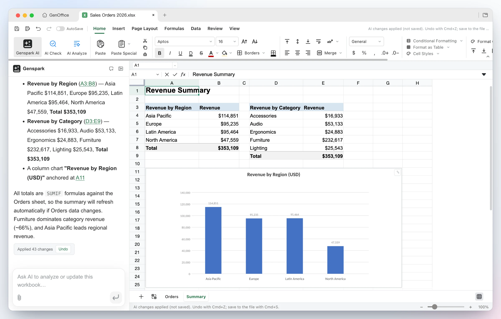</td>
<td width="50%">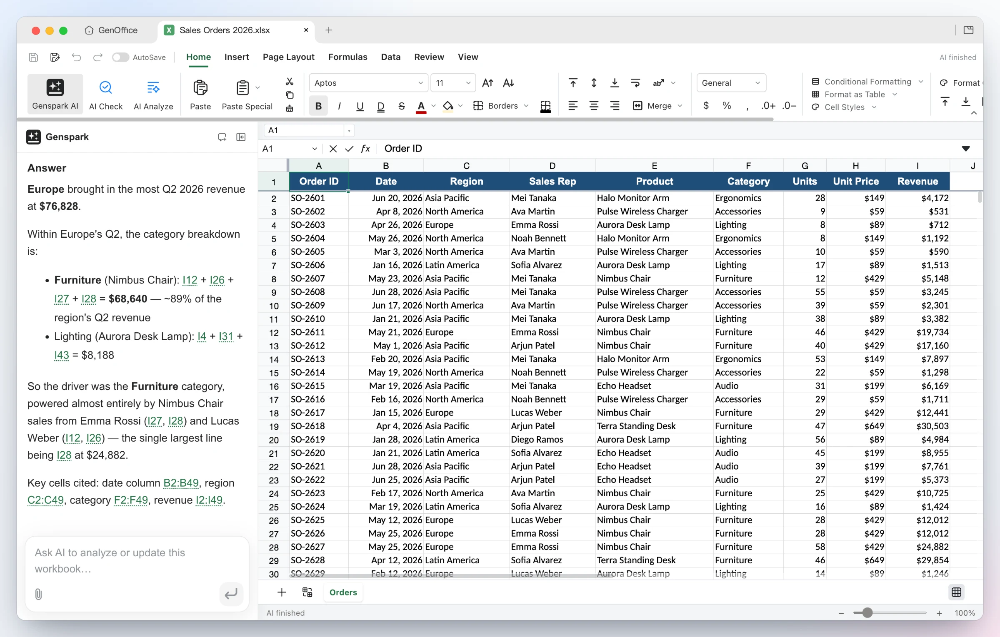</td>
</tr>
<tr>
<td><b>构建它</b> — 仅凭一句话，智能体便添加了带真实 <code>SUMIF</code> 公式的 Summary 工作表，按地区和类别汇总，插入柱状图，并将 43 处修改作为单个可撤销批次应用。</td>
<td><b>询问它</b> — 关于工作簿的问题会返回推理过程和所用确切单元格，以可点击引用形式呈现。底层：自研 Rust `.xlsx` 引擎、数据透视表、切片器、条件格式和公式追踪。</td>
</tr>
</table>

### 3 · Slides — 从提示词到 `.pptx` 幻灯片组

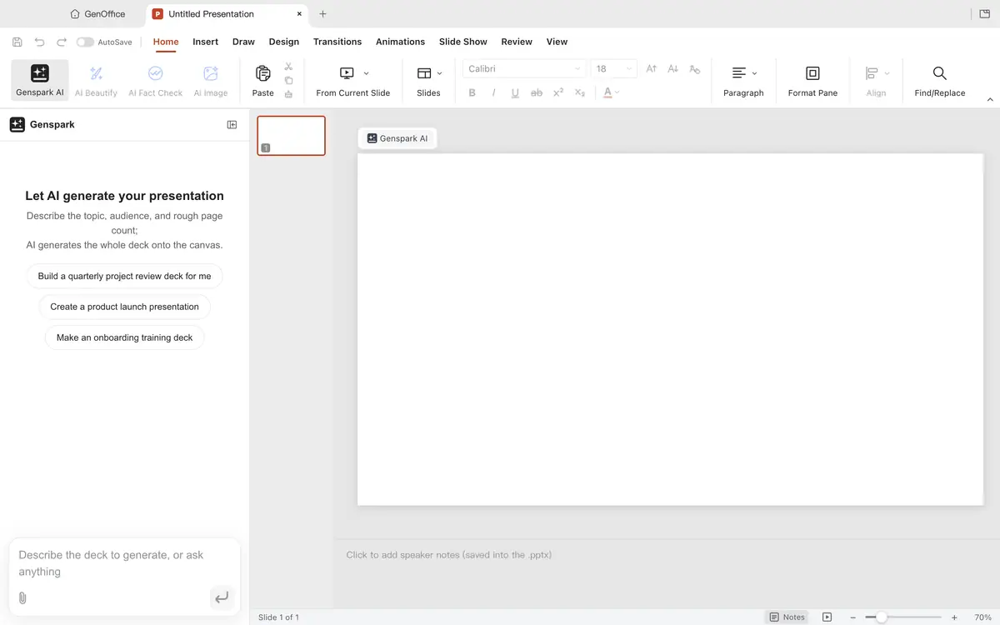

<table>
<tr>
<td width="50%">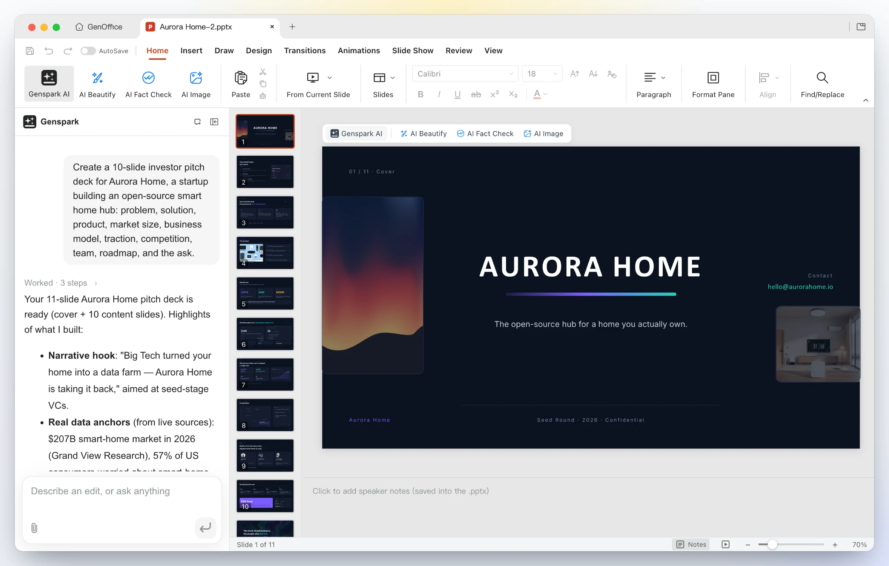</td>
<td width="50%">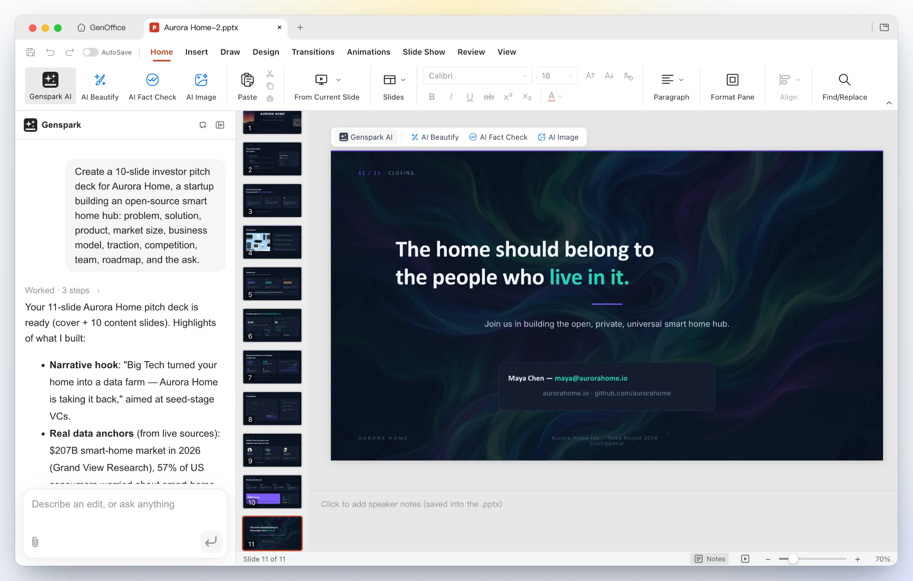</td>
</tr>
<tr>
<td><b>输入一行</b> — “为 Aurora Home 创建一份 10 页投资者路演演示文稿……”。GenOffice 规划叙事线、查找数据，并直接在画布上以真正的 `.pptx` 形式撰写每张幻灯片。</td>
<td><b>输出完整演示文稿</b> — 十一张设计感幻灯片，排版和图标风格统一，结尾有行动号召；可继续用母版、版式、智能参考线和非破坏性裁剪编辑，或让面板重新设计样式、重写和重排。</td>
</tr>
</table>

### 4 · PDF — 就地编辑 PDF 文本，本地将 PDF 转为 Word

<table>
<tr>
<td width="50%">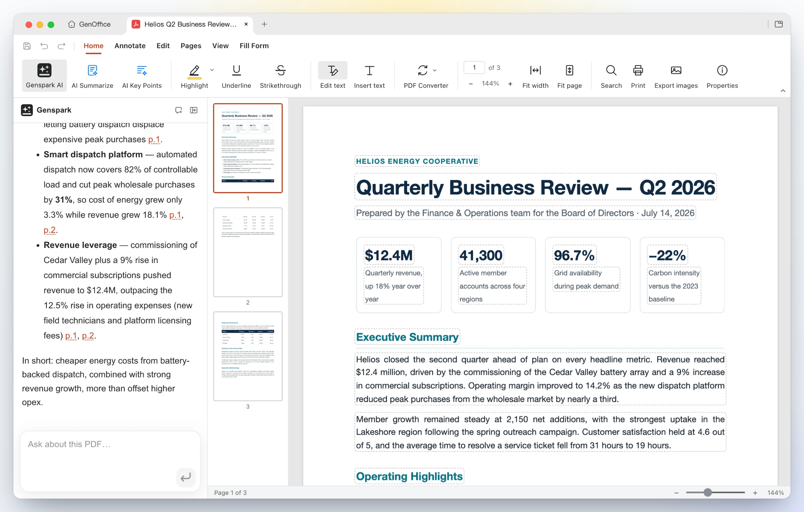</td>
<td width="50%">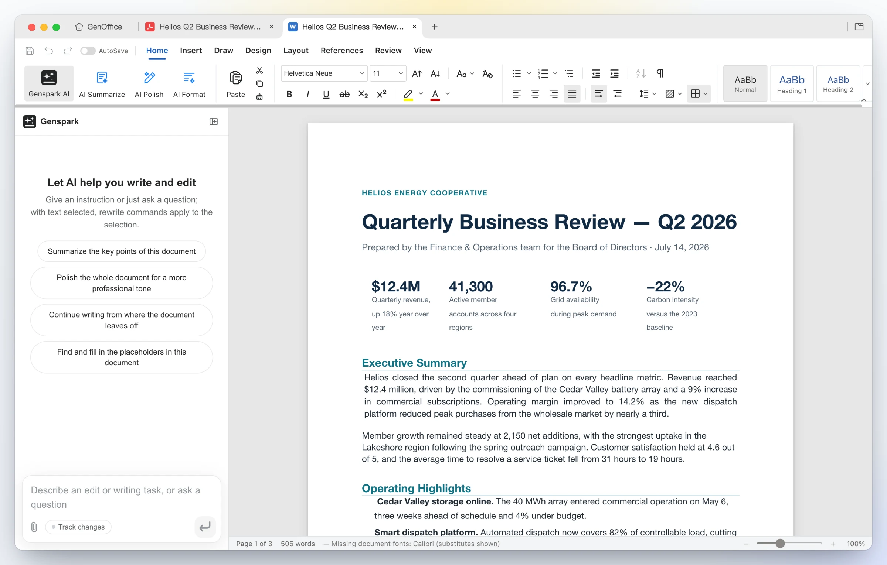</td>
</tr>
<tr>
<td><b>在页面内编辑</b> — 编辑文本模式框出每个文本块以便就地重新输入；内容流通过 PDFium 用原始字体重写，而非叠加注释。向 AI 询问长报告，获得带页码引用的回答。</td>
<td><b>本地转换</b> — <b>PDF 转换器 → PDF 转 Word</b> 生成可编辑的 `.docx`，在 Docs 中与源文件并排打开，标题、统计行和段落完好。Excel 和 PowerPoint 目标同理；扫描页通过系统 OCR 处理。</td>
</tr>
</table>

### 5 · HTML — AI 页面和界面生成器，先出设计简报

告诉它页面的用途和受众。AI 先提出一份
**设计简报**——标语、配色、排版和风格方向——然后
基于这些令牌构建独立的 `.html` 文件。

<table>
<tr>
<td width="50%"></td>
<td width="50%">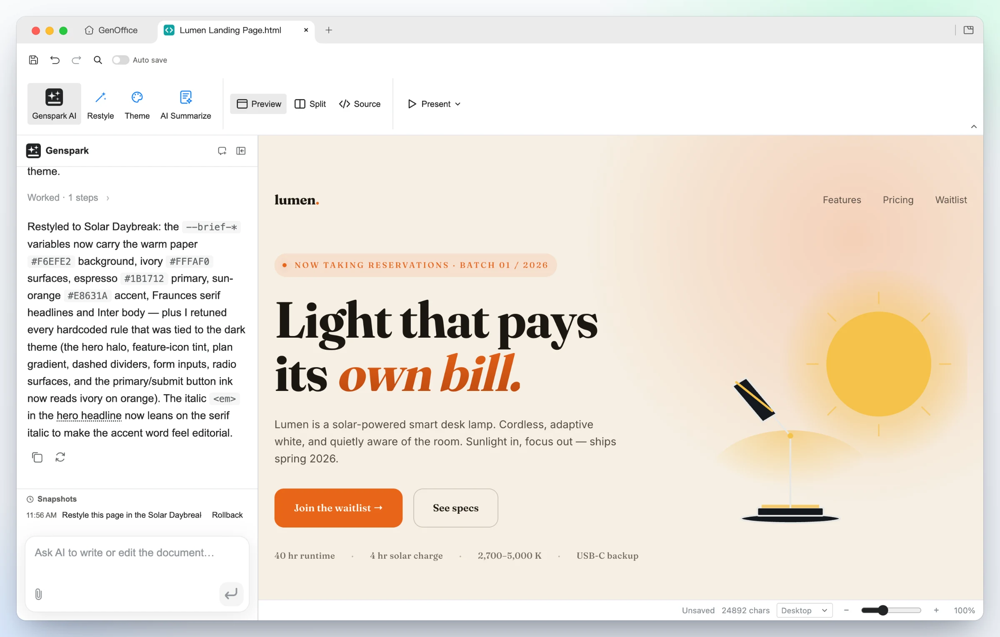</td>
</tr>
<tr>
<td><b>一句话生成</b> — 为 Lumen 打造醒目标语、功能卡片、定价网格和等候名单表单，采用 Midnight Studio 风格。点击任意元素重新设计样式，双击编辑文本，或切换到 CodeMirror 源码视图。</td>
<td><b>同一设计，新风格</b> — 一次<b>重新设计</b>请求替换简报令牌，页面随之变化：暖色纸张、编辑衬线体、阳光橙强调色，内容不变。全屏演示，或导出为 PDF 或原生可编辑 Word 文档。</td>
</tr>
</table>
<table>
<tr>
<td width="50%"></td>
<td width="50%"></td>
</tr>
<tr>
<td><b>界面原型</b> — “个人仪表盘”起始模板将人物设定转化为可用布局：侧边栏、问候语、计费小时迷你图、发票和利用率卡片，全部是真实 HTML，可交给开发者。</td>
<td><b>数据叙事</b> — “数据报告”起始模板构建编辑式大报：衬线标题横幅、主要数字、分隔线统计行、内嵌 SVG 图表和方法说明。</td>
</tr>
</table>

### 6 · Markdown — 基于原始 `.md` 的块编辑器，支持 Ask AI

<table>
<tr>
<td width="50%">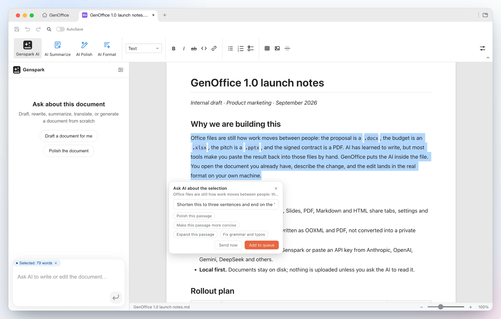</td>
<td width="50%"></td>
</tr>
<tr>
<td><b>针对选区询问 AI</b> — 选中任意段落，出现 <b>Ask AI</b> 标签：输入指令或选择建议，立即发送，或将多个锚定修改排队一次性执行。每个应用都有相同入口。</td>
<td><b>渲染，保存为原始 Markdown</b> — Tiptap 块编辑器中的标题、列表、表格、图片、代码块和 Mermaid 图表，重写为原始 `.md`，并支持完全本地的 <b>Markdown → Word</b> 导出。</td>
</tr>
</table>

### 7 · CLI — 你的编码智能体在你的机器上驱动 GenOffice

GenOffice 内置 `genoffice` 命令行和智能体 skill。
安装 skill 后，Claude Code、Codex、Cursor、Gemini CLI、GitHub Copilot、
OpenCode 或 Windsurf 可通过与应用相同的引擎创建、转换、读取和修改真实
Office 文件，无需打开窗口。

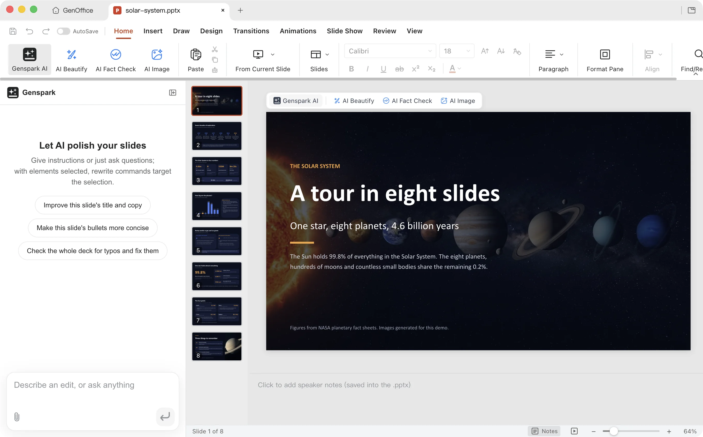

<table>
<tr>
<td width="50%"></td>
<td width="50%"></td>
</tr>
<tr>
<td><b>向智能体发一条提示</b> — “构建一份关于太阳系的八页演示文稿。”智能体读取 skill，编写样式表、大纲和每页规格，用 <code>genoffice image</code> 生成两张图片，让 <code>genoffice slides check</code> 拒绝任何溢出或重叠的内容，然后 <code>genoffice create</code> 组装 <code>.pptx</code>，<code>slides render</code> 返回每页 PNG 供检查。</td>
<td><b>一次安装，从设置 → 集成</b> — GenOffice 列出本机找到的编码智能体，并将 skill 写入你选择的每一个。或下载 skill 压缩包，或运行 <code>npx skills add genspark-ai/genoffice</code>。命令和完整工作流见<a href="#command-line-and-agent-skill">命令行和智能体 skill</a>。</td>
</tr>
</table>

### 8 · MCP — 通过 Model Context Protocol 使用相同工具

每条 `genoffice` 命令也是 MCP 工具。Claude Code、Claude
Desktop、Cursor 及任何其他 MCP 客户端可自行启动 `genoffice mcp`，
无需安装 skill 或打开窗口，获得 29 个
工具以及作为资源的操作参考。应用内的第二个 HTTP 服务器让智能体
在你眼前于可见编辑器标签页中构建 Word 文档。

<img src="../assets/readme/mcp-deck-motion.webp" alt="Claude Code 通过 genoffice MCP 服务器构建八页可再生能源投资演示文稿的延时：搜索数据和图片，用 media 检查每张候选图片，deck_start 写入样式表和大纲，deck_page 逐页添加已验证页面，deck_build 组装 .pptx，slides_render 返回每张幻灯片图像；完成的演示